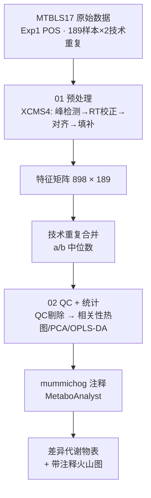

# 基于非靶向 LC-MS 代谢组学的肝细胞癌血清代谢特征分析

基于 MetaboLights 公共数据集 [MTBLS17](https://www.ebi.ac.uk/metabolights/MTBLS17)，
使用 R/Bioconductor 对肝细胞癌（HCC）患者与肝硬化对照（CRR）的血清非靶向 LC-MS
代谢组数据完成全流程分析：数据预处理 → 质量控制 → 多变量/单变量统计 → 代谢物注释 →
生物学解释，用于展示非靶向代谢组学的标准生信分析能力。

## 分析流程



## 结果一览

| 分析 | 关键数字 | 图表 |
| --- | --- | --- |
| 技术重复性 QC | a/b 中位数 r = 0.96；剔除 2 个 r<0.8 样本 | 分布图 |
| 样本间相关 | 未见分组聚类，个体差异为主 | 热图 |
| PCA | PC1 30.6% + PC2 16.2%，两组重叠 | 得分图 |
| OPLS-DA | R2Y = 0.187，Q2 ≈ 0.04，p1 不显著 | 得分图 |
| 注释 | 12 编号获得名称（KEGG API） | 标注火山图 |

## 目录结构

```
mtbls17-metabolomics/
├── README.md                       ← 本文件
├── scripts/
│   ├── 01_preprocess.R               ← 上游预处理
│   └── 02_qc_stats.R                 ← QC、统计、可视化、注释合并
├── report/
│   └── metabolomics_report.qmd       ← 分析报告 [待完成]
├── results/
│   └── figures/                      ← 分析图（PDF）
│       ├── technical_replicates_Spearman.pdf
│       ├── sample_Spearman_heatmap.pdf
│       ├── fig_PCA.pdf
│       ├── fig_oplsda_scores.pdf
│       └── fig_volcano.pdf
└── .gitignore
```

## 数据说明

| 项目 | 内容 |
| --- | --- |
| 数据来源 | MetaboLights MTBLS17 |
| 研究设计 | 78 HCC vs 184 肝硬化，人血清，UPLC-QTOF MS |
| 使用子集 | Experiment 1，正离子模式，189 生物学样本（各 2 次技术重复） |
| 最终分析集 | 898 特征 × 187 样本（剔除 2 个低质量样本后） |

## 方法摘要

**预处理**（xcms 4.4，centWave）：针对 2010 年 QTOF 数据集强度标尺较小的特点
（谱图最大强度中位数约 800），将 prefilter 阈值由默认 1000 调至 100、snthresh 由 10 调至 5；
Obiwarp 保留时间校正；PeakDensity 跨样本对齐；ChromPeakArea 缺失值填补；
检出率过滤（>80%）+ 半最小值填补；a/b 技术重复取中位数合并。

**统计**：Pareto 缩放；PCA（无监督探索）；OPLS-DA（有监督，含 200 次置换检验，
并以 scaleC="pareto" 复核缩放设置）；逐特征 t 检验 + BH 校正；
火山图按调控方向着色（p<0.05 且 FC>1.5 上调为红色，下调为蓝色）。

**注释**：MetaboAnalyst Functional Analysis [LC-MS1]（mummichog，positive 模式，p<0.05）；
每个特征保留质量差最小候选；KEGG API 编号转名称。
注：无 MS/MS 信息，注释为 level 3 推测性注释。

注：所有图由 R 生成后，经 Adobe Illustrator 进行字体与排版优化；数据内容未作任何修改，分析脚本可复现原始图形。

## 复现方法

### 环境

- R ≥ 4.3，Bioconductor，核心包：`xcms` 4.4、`MsExperiment`、`ropls`、`pheatmap`、`tidyverse`、`ggrepel`
- 完整环境见 `docs/sessionInfo_01.txt` / `docs/sessionInfo_02.txt`

```r
if (!require("BiocManager", quietly = TRUE)) install.packages("BiocManager")
BiocManager::install(c("xcms", "MsExperiment"))
install.packages(c("tidyverse", "ropls", "pheatmap", "ggrepel"))
```

### 数据下载

从 MetaboLights FTP 下载 Exp1 正离子模式 CDF 文件：
<https://ftp.ebi.ac.uk/pub/databases/metabolights/studies/public/MTBLS17/>

### 运行

```r
# 1. 修改脚本中的 out_dir / data_dir 路径
# 2. 依次运行
source("scripts/01_preprocess.R")   # 上游预处理
source("scripts/02_qc_stats.R")     # 统计与出图

# 3. 02 脚本运行至导出 mummichog_input_full.txt 后：
#    上传 MetaboAnalyst → Functional Analysis [LC-MS1] → 下载匹配表 → 继续运行
```

## 分析报告

📊 **[在线分析报告]**（GitHub Pages）[待发布]

## 参考文献

Ressom HW, Xiao JF, Tuli L, et al. Utilization of metabolomics to identify serum biomarkers for
hepatocellular carcinoma in patients with liver cirrhosis. Anal Chim Acta. 2012 Sep 19;743:90-100.
doi: 10.1016/j.aca.2012.07.013. Epub 2012 Jul 20. PMID: 22882828; PMCID: PMC3419576.

## License

MIT
